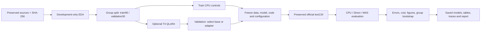
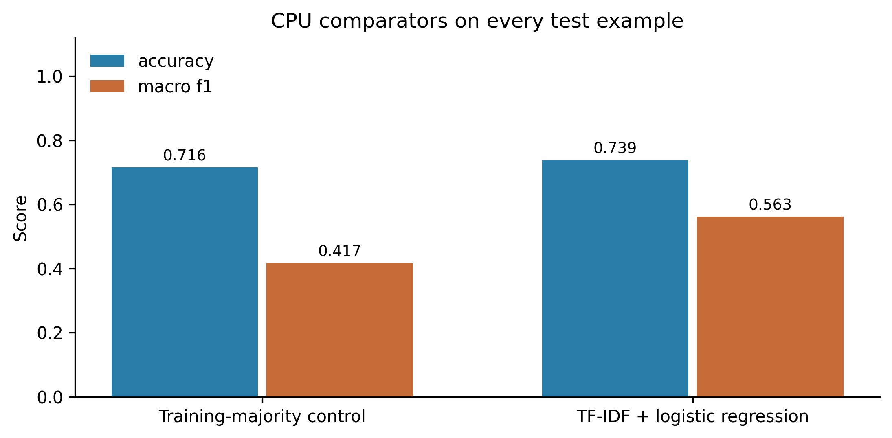
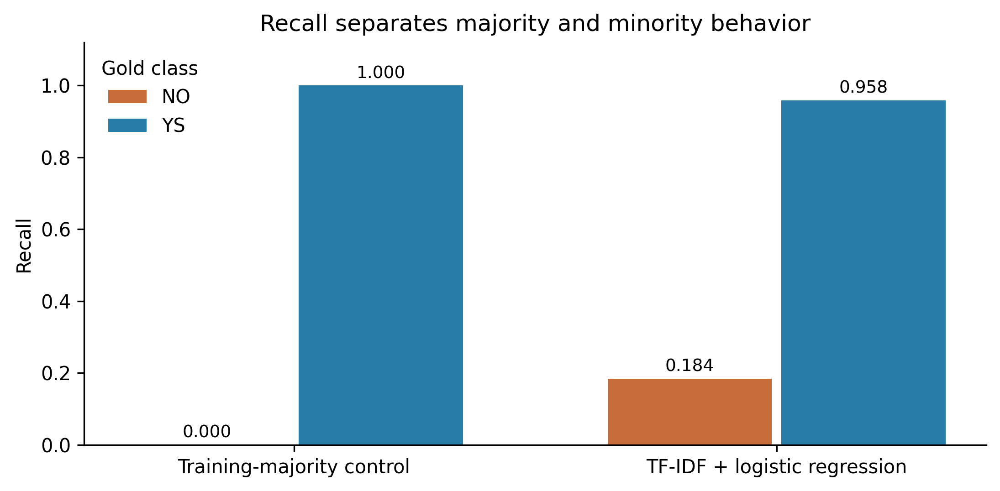

# MASHeart

**A complete, step-by-step research project for cardiovascular text stance and evidence-grounded multi-agent review.**

MASHeart includes attributed data, reusable Python modules, independent Colab notebooks, fixed configuration, measured CPU results, scientific figures with their source tables, trained CPU models, raw-output handling, tests and reproducibility records. Project code, documentation and notebooks are in English.

The task is **question + supplied statement → YS/NO stance**. `YS` means affirmation of what the question asks; `NO` includes negation or lack of affirmation. These labels do not establish clinical truth or provide patient diagnosis. The project adapts Task A from the original HeartMAS notebook into a standalone research package; it does not reproduce the original frozen Qwen3-8B study.

## Start here

- **Notebook users:** upload [MASHeart_Step_by_Step.ipynb](notebooks/MASHeart_Step_by_Step.ipynb) to Google Colab. It carries its own verified source/data bootstrap, so a single notebook upload works. Select T4 for optional QLoRA/MAS; the CPU workflow runs without a GPU. Start with [01_Data_Exploration.ipynb](notebooks/01_Data_Exploration.ipynb) for development-only EDA.
- **Python users:** follow the commands below from this folder. Read [the walkthrough](docs/STEP_BY_STEP.md) for explanations of every stage.
- **Research readers:** read [the protocol](docs/RESEARCH_PROTOCOL.md), [data and methods](docs/DATA_AND_METHODS.md), [the executed CPU report](results/cpu_reference/reports/CPU_RESEARCH_REPORT.md), and [results and limitations](docs/RESULTS_AND_LIMITATIONS.md).
- **Teachers:** use the [60-minute teaching guide](docs/TEACHING_GUIDE_60MIN.md). Download/train/full MAS should be prepared before a timed lesson.

## Research pipeline



The development release contains 125 examples in 11 linked source groups. Only development is divided into training (95/8 groups) and validation (30/3 groups), with seed 17. The preserved official test contains 134 examples/10 groups. There is no independent official training set in this release. Vocabulary, IDF and classifier weights are fitted only on training; no full-development refit occurs after validation.

The CPU model combines word(1,2) and char_wb(3,5) TF-IDF features into **one** balanced Logistic Regression with C=1. A training-majority control provides a minimum comparator.

The optional GPU path uses pinned Qwen3-4B-Instruct-2507, NF4/FP16 and small q/v LoRA adapters on a T4-class GPU. The best adapter checkpoint is chosen by validation loss. Validation macro-F1 selects base or adapter for Analyst, with ties retaining base. Reviewer and Verifier use the base instruct model. The flow is Analyst → Reviewer → Verifier → structural source-quote gate. Valid quotes must be nonempty, exact and unique in the statement; wording provenance is not proof of correct inference. Full-test errors, INVALID outputs and review flags remain visible.

## Installation and commands

The reference environment uses Python 3.12. The project metadata supports Python 3.10–3.12. Create and activate a virtual environment, then install the recorded requirements:

```bash
python -m venv .venv
# Linux/macOS: source .venv/bin/activate
# PowerShell: .venv\Scripts\Activate.ps1
python -m pip install -r requirements.txt
# Optional editable installation; python -m masheart also works from this folder.
python -m pip install -e .
```

Run the full workflow or individual entry points:

```bash
# Verify source bytes/provenance without parsing test labels.
python -m masheart audit

# Make the development group split visible as training/validation JSONL files.
python -m masheart setup-data --output runs/data_setup

# Train, validate, freeze, test, visualize and report in a new directory.
python -m masheart run --mode cpu --config configs/cpu.json --output results/my_cpu_run

# Redraw scientific figures from a completed CPU run, without retraining.
python -m masheart visualize --run-dir results/my_cpu_run

# Apply a saved CPU Pipeline to a synthetic English question and statement.
python -m masheart predict --model results/cpu_reference/models/tfidf_logreg.joblib --question "Does treatment X reduce outcome Y?" --statement "The synthetic study did not find a reduction in outcome Y."
```

For T4, keep Colab's CUDA-enabled PyTorch and install the pinned optional stack:

```bash
python -m pip install -r requirements-t4.txt
python -m masheart run --mode t4 --config configs/t4.json --output results/my_t4_run
```

CPU runs refuse a nonempty destination. T4 checkpoints can resume only when the source, training state, prompts, configuration and frozen provenance agree; failed outputs are retained rather than silently retried. All runtime storage needs to be saved before Colab reclaims a session.

## Measured results included

The distributed [CPU reference](results/cpu_reference/reports/run_summary.json) was actually executed on all 134 test examples. The following numbers are read from [test_metrics.csv](results/cpu_reference/tables/test_metrics.csv):

| System | Test n | Accuracy | Macro-F1 | Recall NO | Recall YS |
|---|---:|---:|---:|---:|---:|
| Training-majority control | 134 | 0.7164 | 0.4174 | 0.0000 | 1.0000 |
| TF-IDF + Logistic Regression | 134 | 0.7388 | 0.5629 | 0.1842 | 0.9583 |

The minority-class recall shows why accuracy alone is insufficient. The 500-draw paired source-group bootstrap estimates the macro-F1 difference at about 0.1456, with percentile interval [0.0000, 0.2416]. Only 10 test groups and prior dataset exposure limit interpretation; this is not a clinically validated effect.

**GPU status:** QLoRA/MAS code and CPU-testable safeguards are included. The packaging host has no CUDA device; GPU training/inference were **not run**, and no Qwen/MAS scores are invented. See [results/gpu/STATUS.json](results/gpu/STATUS.json). Source/module tests are distinct from a hardware execution benchmark.

## Scientific figures and their evidence

Eight reference figures are stored as 300-dpi PNG and scalable SVG: development label balance, development lengths, source-group split, test confusion matrices, test metric comparison, per-class recall, source-group accuracy, and paired cluster bootstrap.





Each figure has an exact CSV input. [figure_data_manifest.json](results/cpu_reference/figures/figure_data_manifest.json) records hashes and paths, so polished graphics can be traced back to complete measurements. Predictions, per-class reports, errors and group summaries remain available for independent inspection.

## Folder layout

```text
MASHeart/
├── README.md, pyproject.toml, requirements*.txt, CITATION.cff, LICENSE_DATA.md
├── configs/                     # Fixed CPU and T4 experiment settings
├── data/
│   ├── raw/                     # Byte-preserved development/test and provenance
│   ├── manifest.json            # Source fingerprints and lineage
│   └── DATA_CARD.md              # Schema, labels, exposure history and licenses
├── masheart/
│   ├── data.py                  # Setup, validation, group splits and input boundary
│   ├── baseline.py, metrics.py   # Trainable controls, complete-denominator scores, CI
│   ├── experiment.py            # Full CPU research workflow
│   ├── gpu.py                   # QLoRA, role MAS, quote gate, freeze, trace checkpoints
│   ├── visualization.py         # Measured PNG/SVG exports with CSV provenance
│   └── cli.py                   # audit / setup-data / run / visualize / predict
├── notebooks/
│   ├── 01_Data_Exploration.ipynb # Development-only scientific exploration
│   └── MASHeart_Step_by_Step.ipynb # Full independent Colab workflow
├── docs/                        # Protocol, methods, walkthrough, interpretation, teaching
├── results/
│   ├── cpu_reference/           # Executed models/tables/figures/reports
│   └── gpu/STATUS.json          # Explicit hardware-execution status
├── tests/                       # Data, metrics, artifacts, parser/gate/mask/resume checks
├── scripts/                     # Notebook builder, verifier and portable ZIP packager
├── reports/                     # Software/notebook/ZIP portability verification
└── MANIFEST.sha256              # Final distribution integrity manifest
```

## Verify and rebuild

```bash
python -m pip install -r requirements-dev.txt
python scripts/verify_project.py
# Optional: fresh-kernel execution of both notebooks in CPU mode.
python scripts/verify_project.py --execute-notebooks --report reports/verification.json
# Rebuild the notebook sources only after deliberately changing source/configuration.
python scripts/build_notebooks.py
# Build a ZIP containing one top-level MASHeart directory.
python scripts/package_project.py
```

The verification report states exactly what was run. The ZIP is also extracted into an isolated location and the CPU experiment rerun to check it does not depend on the original workspace. Generated runtime/checkpoint caches and downloaded LLM base weights are excluded; the small trained CPU models and measured reference artifacts are included.

## Attribution and scope

PCC questions/statements/stance labels: Abdulaziz Alamri and Mark Stevenson, [2016](https://doi.org/10.1186/s13326-016-0083-z). Linked official membership follows BioClaim by Youngwoo Kim, Razieh Rahimi and James Allan, [2023](https://aclanthology.org/2023.findings-emnlp.456/), revision 14e88c344c148c46bb6dbaab2149b252b5e030d3. Preserve the PCC CC BY-NC-SA 2.0 UK notice and the recorded upstream BioClaim license discrepancy. Model weights have a separate license and are not included. See [LICENSE_DATA.md](LICENSE_DATA.md) and [CITATION.cff](CITATION.cff).

The original project developed on dev and an earlier version encountered test; regrouping does not erase that history. MASHeart reports educational development fitting on a small, related scientific-text corpus. It supplies no patient-specific diagnosis or treatment recommendation.
